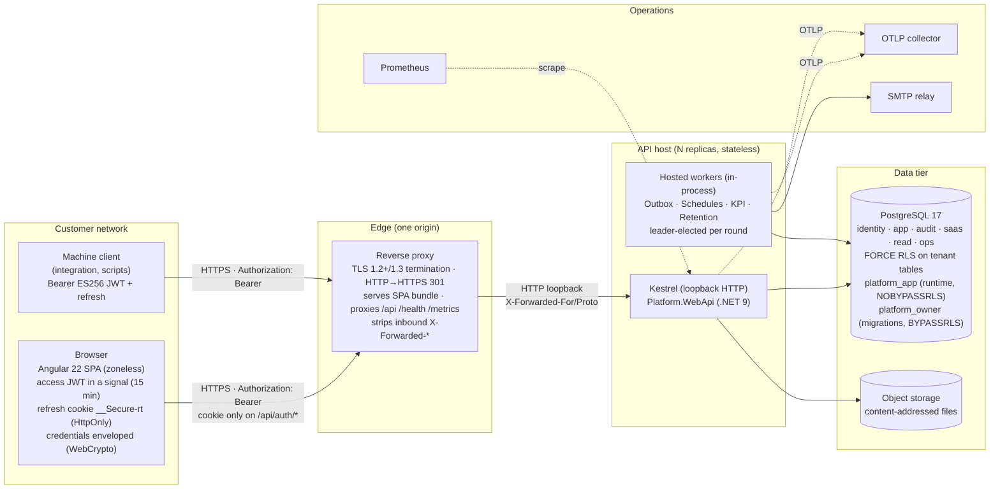
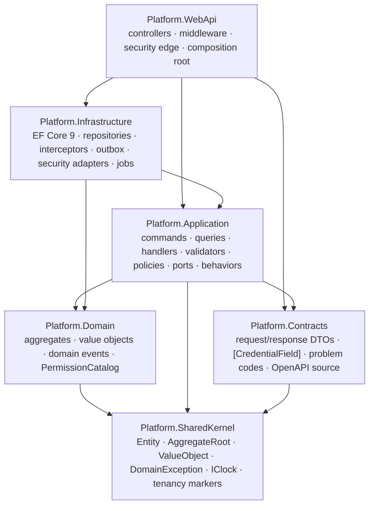

# 01 — System Architecture Blueprint

| Field | Value |
| ----- | ----- |
| Scope | Target architecture for the Version 2 platform: topology, layer mapping, project and folder structure, tenancy and database pattern, frontend architecture, cross-cutting services, enforcement gates |
| Audience | Solution architects, lead developers |
| Status | **Ratified for Phase 1 (2026-10-08).** Decisions `D-01` … `D-07` from `00 §0` are locked; `[C-nn]` marks items adopted from the critique |
| Platform (D-05) | .NET 9 / C# 13, EF Core 9, Npgsql 9, PostgreSQL 17, Angular 22 (zoneless). LTS upgrade date: open action A-1 |

## Decisions this document implements

| Decision | What it fixes here |
| --- | --- |
| **D-01** | Access JWT (ES256, 15 min) held in SPA memory; rotating refresh token in `__Secure-rt` cookie against `identity.refresh_sessions`; single-flight silent refresh (§2.2, §4.7, §6.1, §6.4) |
| **D-02** | `sub` AES-256-GCM encrypted; `email`, `name`, `role` absent from the token; identity resolved per request (§2.2, §5.3) |
| **D-03** | Credential envelope mandatory in the WebApi core; `[CredentialField]` on every password property; shared nonce and key store (§3.2, §4.8, §6.4) |
| **D-04** | Deny-by-default on commands **and** queries; `RequestPolicyTests` (§3.4, §8) |
| **D-05** | Version pins throughout |
| **D-06** | `identity.platform_users` + `app.tenant_memberships` under `FORCE RLS` with `(tenant_id, id)` keys (§4.1, §4.7) |
| **D-07** | Domain-agnostic: no business rule is hardcoded. The platform offers building blocks (permissioned commands, audit stamps, an optional `Approval` value object, SoD helpers, a frozen-state immutability trigger, the tamper-evident audit trail); the business defines how they are used per domain (§2.3, §3.3, §4.2, §4.8). Code samples use the illustrative placeholder aggregate `WorkItem`, which carries no business meaning |

Names used here (`Platform.*`, schemas `identity`/`app`/`audit`/`saas`/`read`/`ops`) are placeholders; the product name replaces `Platform` once chosen.

---

## 1. Topology



Rules the topology encodes:

1. **One origin.** The proxy serves the SPA and forwards `/api`, `/health`, `/metrics`. The API registers no CORS policy.
2. **TLS terminates at the proxy; HSTS is emitted by the application.** The proxy forwards `X-Forwarded-For`/`-Proto` and discards those headers if a client sent them.
3. **The API host is stateless.** Sessions, refresh tokens, envelope keys, nonces, idempotency responses, rate-limit counters (when N > 1) and outbox claims live in PostgreSQL `[C-08]`.
4. **Workers run in-process** with leader election by advisory lock per round.
5. **Two database roles.** `platform_app` at runtime: no `SUPERUSER`, no `BYPASSRLS`, not a table owner, `SELECT`/`INSERT` only on `audit.*`. `platform_owner` runs migrations with `BYPASSRLS` `[C-10]`. The start-up guard refuses an over-privileged runtime role in **every** environment `[C-07]`.

---

## 2. Clean Architecture mapping

### 2.1 Assemblies and the dependency rule



| Assembly | May reference | Must never reference | Gate |
| --- | --- | --- | --- |
| `SharedKernel` | BCL only | anything else | `LayerRulesTests` |
| `Domain` | `SharedKernel` | EF Core, ASP.NET, MediatR, Contracts, Application | `LayerRulesTests`, `DomainHardeningTests` |
| `Contracts` | `SharedKernel` (`DomainFault`, codes) | Domain entities | `LayerRulesTests` |
| `Application` | `Domain`, `Contracts`, `SharedKernel`, MediatR, FluentValidation | EF Core, Npgsql, ASP.NET, `HttpContext` | `LayerRulesTests.Application_carries_no_EntityFrameworkCore` |
| `Infrastructure` | `Application`, `Domain`, `SharedKernel`, EF Core, Npgsql | ASP.NET MVC types | `InfrastructureHardeningTests` |
| `WebApi` | everything | — ; controllers inject only `ISender` | `WebApiHardeningTests` |

### 2.2 One request shape (D-01, D-02, D-03, D-04)

```mermaid
sequenceDiagram
    participant C as SPA
    participant E as Security edge
    participant K as Controller
    participant D as MediatR pipeline
    participant H as Handler
    participant R as Repository / UoW
    participant DB as PostgreSQL 17

    C->>E: HTTPS · Authorization: Bearer <ES256 JWT>
    E->>E: forwarded headers · correlation · security headers
    E->>E: JWT: signature (ES256, kid) · lifetime · iss/aud
    E->>E: OnTokenValidated: decrypt sub (AES-256-GCM) → user id; read sid
    E->>DB: one query: refresh_session(sid) ⋈ platform_users ⋈ tenant_memberships ⋈ roles ⋈ permissions
    DB-->>E: active? revoked? tenant, role, permissions, display name
    E->>E: rate limit (policy partition) · tenant GUC prepared · MFA scope gate
    E->>K: HttpContext with ICurrentUser / ICurrentTenant / IUserPrivileges
    K->>K: CredentialTransportFilter opens every [CredentialField] (D-03)
    K->>D: sender.Send(command | query)
    D->>D: Tracing → Logging → Authorization (policy attribute on commands AND queries, D-04)
    D->>D: Validation (shape) → Idempotency (commands with a key)
    D->>H: Handle
    H->>R: GetForUpdateAsync (tracked) | projection (untracked → DTO)
    R->>DB: SQL under RLS (GUC stamped on connection open)
    H->>H: aggregate.Transition(actor, clock, …) → events raised
    H->>R: unitOfWork.SaveChangesAsync (one commit)
    R->>DB: interceptors: tenant stamp · audit stamp · field change · outbox · scope guard
    DB-->>H: ok / 409 (xmin) / RLS WITH CHECK refusal
    H-->>K: id | DTO
    K-->>C: 2xx or application/problem+json with code
```

### 2.3 Responsibilities, stated once

| Concern | Lives in | Never in |
| --- | --- | --- |
| Shape validation | FluentValidation validator beside the request | Domain |
| Business invariants, transitions, SoD | Aggregate methods | Validators, handlers, controllers, SQL |
| Transition metadata a domain chooses to record (for example an `Approval` value: actor id, time, comment) | Set by the aggregate method from the actor and `IClock` | Request body, controller |
| Coded refusals (`XXX-404`, conflicts, visibility) | Handler, with `DomainFault` | Repository |
| SQL, `Include`, projections, paging | Infrastructure repository | Application |
| The single commit | Handler via `IUnitOfWork` | Repository, interceptor, controller |
| Tenant id on new rows | `TenantStampInterceptor` from `ICurrentTenant` | Domain, handler, request body |
| Audit attribution (user id, display name as of the action) | `AuditStampInterceptor` from `ICurrentUser` (resolved per request, not from the token) | Token claims |
| Reasons and comments the business requires | Typed, validated command properties → aggregate → event `[C-14]` | HTTP headers |
| Authorization decision | `AuthorizationBehavior` from the policy attribute (commands and queries, D-04) | `[Authorize(Roles=...)]` |
| Credential transport | `CredentialTransportFilter` (D-03), the only code that knows a field was enveloped | Handlers, Application, Domain |
| Token identity | `EncryptedSubjectEvents.OnTokenValidated` (D-02), the only code that decrypts `sub` | Anything downstream |
| Time | `IClock` | `DateTime.Now` |
| Identifiers | `Guid.CreateVersion7()` in `Entity` | Database defaults |

---

## 3. Project and folder structure (backend)

### 3.1 Principle: module-first inside every layer `[C-19]`

Every assembly has the same first-level module folders with the same names. Boundary tests run per layer. The **platform modules** below ship with the starter kit; **business modules** are added one folder per bounded context as the domain is defined (document 03).

```text
Platform modules (shipped):   Identity   Tenancy   Organization   Notifications   AuditLedger   Reporting   Files
Business modules (per domain): <BusinessModuleA>   <BusinessModuleB>   …   (same internal shape as below)
```

### 3.2 Tree

```text
Platform.sln
├── Directory.Build.props                   # TreatWarningsAsErrors, nullable, analyzers, LangVersion 13, net9.0
├── Directory.Packages.props                # central package versions (MediatR pinned; see README A-2)
├── .editorconfig
├── global.json                             # pins the .NET 9 SDK band
│
├── src/
│   ├── Platform.SharedKernel/
│   │   ├── Primitives/
│   │   │   ├── Entity.cs                   # Guid v7 minted here
│   │   │   ├── AggregateRoot.cs            # domain events, audit stamps, EnsureActorIsNotCreator (SoD helper)
│   │   │   ├── ValueObject.cs
│   │   │   ├── DomainEvent.cs
│   │   │   ├── DomainException.cs          # + DomainFault
│   │   │   ├── InvalidStateTransitionException.cs
│   │   │   └── Approval.cs                 # optional value object (actor id, time, comment) for aggregates a domain gives an approval gate
│   │   ├── MultiTenancy/
│   │   │   ├── ITenantScoped.cs
│   │   │   └── IAllocatable.cs             # BranchId / DepartmentId working scope
│   │   ├── Abstractions/IClock.cs
│   │   └── Localization/LocalizedText.cs
│   │
│   ├── Platform.Domain/
│   │   ├── Authorization/
│   │   │   ├── PermissionAction.cs         # View · Create · Edit · Approve · Cancel · Export · Manage · ViewConfidential
│   │   │   ├── PermissionModule.cs
│   │   │   └── PermissionCatalog.cs
│   │   ├── Identity/                       # PlatformUser (credentials, MFA, lockout), Credential VOs
│   │   ├── Tenancy/                        # Tenant, Plan, TenantMembership (role, scope)
│   │   ├── <BusinessModule>/               # one folder per bounded context, added as the domain is defined
│   │   │   ├── <Aggregate>.cs              # aggregate root
│   │   │   ├── <Child>.cs                  # child entity
│   │   │   ├── <Aggregate>Status.cs        # state enum
│   │   │   ├── <Aggregate>Events.cs        # past-tense records
│   │   │   └── <Module>Codes.cs            # "<MOD>-001" … refusal-code constants
│   │   └── ... same internal shape for every module
│   │
│   ├── Platform.Contracts/
│   │   ├── Common/
│   │   │   ├── Paged.cs · PageQuery.cs · CreatedResource.cs
│   │   │   ├── ProblemCodes.cs             # AUTHZ-*, AUTH-*, TENANT-*, CRED-*, RATE-429, CONCURRENCY-409 …
│   │   │   └── CredentialFieldAttribute.cs # D-03: marks every password property
│   │   ├── Identity/                       # SignInRequest, MfaVerifyRequest, AuthResponse, CredentialChallengeResponse …
│   │   ├── <BusinessModule>/               # <Aggregate>ListItem, <Aggregate>Detail, Create<Aggregate>Request …
│   │   └── ... one folder per module
│   │
│   ├── Platform.Application/
│   │   ├── Abstractions/
│   │   │   ├── Messaging.cs                # ICommand<>, IQuery<>, handlers (MediatR IRequest shapes), DomainEventNotification<>
│   │   │   ├── Persistence/                # IRepository<T>, IUnitOfWork
│   │   │   ├── Security/                   # ICurrentUser, ICurrentTenant(+Setter), IUserPrivileges
│   │   │   │   └── RequestPolicyAttributes.cs   # RequirePermissionPolicy, RequireAuthenticatedActor, AllowUnauthenticated
│   │   │   ├── Audit/                      # ISecurityEventLog, IAuditTrailReader
│   │   │   ├── Tokens/                     # IAccessTokenService, IRefreshSessionRepository, ISubjectProtector (D-01, D-02)
│   │   │   ├── CredentialTransport/        # ICredentialEnvelopeOpener, ICredentialChallengeIssuer (D-03)
│   │   │   ├── Idempotency/
│   │   │   ├── Files/IFileStorage.cs
│   │   │   └── Paging.cs
│   │   ├── Behaviors/
│   │   │   ├── TracingBehavior.cs
│   │   │   ├── LoggingBehavior.cs
│   │   │   ├── AuthorizationBehavior.cs    # D-04: ICommand<> and IQuery<> both gated
│   │   │   ├── ValidationBehavior.cs
│   │   │   └── IdempotencyBehavior.cs
│   │   ├── Identity/
│   │   │   ├── Commands/SignIn.cs · VerifyMfa.cs · RefreshSession.cs · SignOut.cs · ChangeMyPassword.cs · Reauthenticate.cs …
│   │   │   └── Queries/IssueCredentialChallenge.cs · GetMySession.cs · GetMyPrivileges.cs
│   │   ├── <BusinessModule>/
│   │   │   ├── I<Aggregate>Repository.cs   # reads + writes for the aggregate (ADR-0010)
│   │   │   ├── Commands/<UseCase>.cs       # record + validator + handler per file
│   │   │   ├── Queries/<UseCase>.cs
│   │   │   └── Policies/<WhenEventThenAction>Policy.cs
│   │   └── ... one folder per module
│   │
│   ├── Platform.Infrastructure/
│   │   ├── DependencyInjection.cs
│   │   ├── Persistence/
│   │   │   ├── AppDbContext.cs
│   │   │   ├── Conventions/                # TenantKeyConvention · TenantFilterConvention · XminConcurrencyConvention · EnumAsStringConvention
│   │   │   ├── Interceptors/               # TenantConnection · TenantStamp · AuditStamp · FieldChange · Outbox · OrgScopeGuard
│   │   │   ├── Outbox/                     # OutboxEvent, OutboxProcessor, AdvisoryLockKeys
│   │   │   ├── Idempotency/
│   │   │   ├── Migrations/
│   │   │   ├── Identity/                   # PlatformUserConfiguration, RefreshSessionConfiguration, repositories
│   │   │   ├── Tenancy/                    # TenantMembershipConfiguration (RLS in its migration), repositories
│   │   │   ├── <BusinessModule>/           # IEntityTypeConfiguration classes + <Aggregate>Repository
│   │   │   └── ... one folder per module
│   │   ├── Security/
│   │   │   ├── Tokens/
│   │   │   │   ├── AccessTokenService.cs          # ES256, 15 min, claims per 02 §4.2
│   │   │   │   ├── SubjectProtector.cs            # D-02: AES-256-GCM over the user id, kid, rotation
│   │   │   │   ├── RefreshTokenFormat.cs          # "<sessionId>.<secret>", SHA-256 stored
│   │   │   │   └── Jwks.cs
│   │   │   ├── CredentialTransport/
│   │   │   │   ├── CredentialEnvelopeOpener.cs    # D-03
│   │   │   │   ├── CredentialChallengeIssuer.cs   # MAC'd nonce, 120 s
│   │   │   │   ├── EnvelopeKeyStore.cs            # shared, protected, rotated 24 h
│   │   │   │   └── NonceStore.cs                  # app.credential_nonces (UNLOGGED), single use
│   │   │   ├── Hashing/Argon2idHasher.cs
│   │   │   ├── Totp/
│   │   │   └── RateLimiting/PostgresRateLimitStore.cs
│   │   ├── Audit/                          # AuditTrailAppender (per-tenant advisory lock), SecurityEventLog, readers
│   │   ├── Jobs/                           # schedules, KPI snapshot, retention purge, leader election
│   │   ├── Storage/ · Email/ · Observability/ · Health/
│   │   └── Configuration/ConfigGuard.cs    # refuses to start on missing or weak secrets, in every environment
│   │
│   └── Platform.WebApi/
│       ├── Program.cs                      # composition only
│       ├── Startup/
│       │   ├── PipelineOrder.cs            # middleware sequence as data, asserted by a test
│       │   ├── JwtBearerSetup.cs           # ES256 validation; MapInboundClaims=false; events wired
│       │   ├── ForwardedHeadersSettings.cs
│       │   └── StartupGuards.cs            # role guard, secret guard, bind guard: ALL environments
│       ├── Security/
│       │   ├── EncryptedSubjectEvents.cs   # D-02: OnTokenValidated decrypts sub, loads session, builds principal
│       │   ├── RefreshCookie.cs            # D-01: __Secure-rt; Path=/api/v1/auth; SameSite=Strict
│       │   ├── AuthOriginCheckMiddleware.cs # Origin / Sec-Fetch-Site on the cookie-bearing /api/v1/auth/* POSTs
│       │   ├── CredentialTransportFilter.cs # D-03: global action filter
│       │   ├── RateLimiting.cs
│       │   └── SecurityHeadersMiddleware.cs
│       ├── Middleware/
│       │   ├── ObservabilityMiddleware.cs
│       │   ├── TenantResolutionMiddleware.cs     # from the resolved principal only
│       │   ├── MfaEnrollmentGateMiddleware.cs
│       │   ├── DomainExceptionHandler.cs
│       │   └── ProblemResponse.cs
│       ├── Controllers/
│       │   ├── Identity/AuthController.cs        # sign-in, mfa, refresh, sign-out, credential-challenge, reauthenticate, me
│       │   ├── <BusinessModule>/<Aggregate>sController.cs
│       │   └── ... one folder per module
│       ├── Versioning/
│       └── appsettings.json                      # no secrets
│
├── tests/
│   ├── Platform.Domain.UnitTests/
│   ├── Platform.Application.UnitTests/        # handlers over an in-memory provider with real interceptors; SubjectProtectorTests; CredentialEnvelopeOpenerTests
│   ├── Platform.Architecture.Tests/           # §8
│   ├── Platform.IntegrationTests/             # real PostgreSQL 17: RLS, triggers, migrations round-trip, chain concurrency
│   └── Platform.WebApi.FunctionalTests/       # WebApplicationFactory: auth flows, refresh rotation, envelope refusals, rate limits, API surface snapshot
│
├── frontend/                                  # §6
├── deploy/                                    # proxy configs, compose, roles.sql, SECRETS.md
├── scripts/
└── docs/  (adr · decisions · reference · HISTORY.md)
```

### 3.3 Conventions inside a module (Application)

A request, its validator and its handler share one file named after the use case. The sample below uses the **illustrative placeholder aggregate `WorkItem`** with a transition the domain has chosen to make an approval gate; which transitions are gates, and under which rules, is an intake decision (document 03), not a platform rule.

```csharp
namespace Platform.Application.WorkItems.Commands;        // illustrative module name

/// <summary>Illustrative: a transition the domain designated as an approval gate.</summary>
[RequirePermissionPolicy(PermissionCatalog.WorkItems, PermissionAction.Approve)]
public sealed record ApproveWorkItemCommand(Guid WorkItemId, string? Comment) : ICommand;

public sealed class ApproveWorkItemValidator : AbstractValidator<ApproveWorkItemCommand>
{
    public ApproveWorkItemValidator()
    {
        RuleFor(x => x.WorkItemId).NotEmpty();
        RuleFor(x => x.Comment).MaximumLength(1000);        // shape only; meaning lives in the aggregate
    }
}

public sealed class ApproveWorkItemHandler(
    IWorkItemRepository items,
    IUnitOfWork unitOfWork,
    ICurrentUser user,
    IClock clock) : ICommandHandler<ApproveWorkItemCommand>
{
    public async Task Handle(ApproveWorkItemCommand command, CancellationToken ct)
    {
        var actor = user.UserId
            ?? throw new DomainException(ProblemCodes.AuthenticatedActorRequired, "An authenticated user is required.", DomainFault.Unauthenticated);

        var item = await items.GetForUpdateAsync(command.WorkItemId, ct)
            ?? throw new DomainException(WorkItemCodes.NotFound, "Work item not found.", DomainFault.NotFound);

        // Whatever the domain defined for this transition runs inside the aggregate: state guard,
        // SoD rule (if any), domain rule (if any), the recorded Approval value, the event.
        item.Approve(actor, clock.UtcNow, command.Comment);

        await unitOfWork.SaveChangesAsync(ct);          // one commit: state change + recorded metadata + events
    }
}
```

Queries carry a policy too (D-04):

```csharp
[RequirePermissionPolicy(PermissionCatalog.WorkItems, PermissionAction.View)]
public sealed record ListWorkItemsQuery(WorkItemStatus? Status, int Page, int PageSize) : IQuery<Paged<WorkItemListItem>>;
```

### 3.4 Dispatcher: MediatR, with authorization on both sides (D-04)

Markers: `ICommand<T> : IRequest<T>`, `IQuery<T> : IRequest<T>`, `DomainEventNotification<TEvent> : INotification`. Behaviors register in the fixed order `Tracing, Logging, Authorization, Validation, Idempotency` (`InterceptorOrderTests`).

```csharp
public sealed class AuthorizationBehavior<TRequest, TResponse>(ICurrentUser currentUser, IUserPrivileges privileges)
    : IPipelineBehavior<TRequest, TResponse> where TRequest : notnull
{
    private static readonly RequestPolicyAttribute? Policy =
        (RequestPolicyAttribute?)Attribute.GetCustomAttribute(typeof(TRequest), typeof(RequestPolicyAttribute));

    private static readonly bool IsGated =                       // D-04: commands AND queries
        typeof(TRequest).GetInterfaces().Any(i => i.IsGenericType
            && (i.GetGenericTypeDefinition() == typeof(ICommand<>) || i.GetGenericTypeDefinition() == typeof(IQuery<>)))
        || typeof(ICommand).IsAssignableFrom(typeof(TRequest));

    public Task<TResponse> Handle(TRequest request, RequestHandlerDelegate<TResponse> next, CancellationToken ct)
    {
        if (!IsGated) return next();

        switch (Policy)
        {
            case null:
                throw new DomainException(ProblemCodes.NoPolicy, $"Request '{typeof(TRequest).Name}' declares no authorization policy.", DomainFault.Refused);
            case AllowUnauthenticatedAttribute:
                return next();                                   // sign-in, credential challenge, refresh
        }

        if (!currentUser.IsAuthenticated)
            throw new DomainException(ProblemCodes.AuthenticatedActorRequired, "An authenticated actor is required.", DomainFault.Unauthenticated);

        var permitted = Policy switch
        {
            RequireAuthenticatedActorAttribute => true,          // self-service: my session, my privileges
            RequirePermissionPolicyAttribute p when !PermissionCatalog.IsKnown(p.PermissionKey)
                => throw new DomainException(ProblemCodes.UnknownPermission, $"Unknown permission '{p.PermissionKey}'.", DomainFault.Refused),
            RequirePermissionPolicyAttribute p => privileges.Has(p.PermissionKey),
            _ => false,
        };

        if (!permitted)
            throw new DomainException(ProblemCodes.Forbidden, "This action is not permitted for the current actor.", DomainFault.Refused);

        return next();
    }
}
```

`RequireRoleAttribute` is not carried into V2: roles are tenant-configurable and the token carries none (D-02); platform-administrator surfaces use `RequirePermissionPolicy(PermissionCatalog.Platform, …)` granted only to platform memberships.

---

## 4. Tenancy and database pattern

### 4.1 Schema layout (D-06)

| Schema | Contents | Tenant column | RLS | Runtime role grants |
| --- | --- | --- | --- | --- |
| `identity` | `platform_users`, `password_history`, `mfa_enrollments`, `recovery_codes`, `refresh_sessions`, `machine_credentials`, `envelope_keys`, `data_protection_keys` | none (platform scope) | none; every query keyed by the authenticated actor's id, by a session id, or by a join from an RLS-filtered membership | SELECT, INSERT, UPDATE |
| `app` | every tenant business table, `tenant_memberships`, `roles`, `role_permissions`, `idempotency_responses`, `credential_nonces` | `tenant_id NOT NULL` (except `credential_nonces`, pre-authentication) | **FORCE**, `tenant_isolation` | SELECT, INSERT, UPDATE, DELETE |
| `audit` | `audit_trail` (hash chain), `field_changes`, `security_events` | nullable (pre-authentication events) | **FORCE**; `WITH CHECK` allows `tenant_id IS NULL` | SELECT, INSERT only |
| `saas` | `tenants`, `plans`, `subscriptions`, `platform_admins` | n/a | none | `tenants` SELECT by id; none on plans/subscriptions |
| `read` | KPI snapshots and projections | `tenant_id NOT NULL` | **FORCE** | SELECT, INSERT, UPDATE |
| `ops` | `outbox_events`, `job_leases`, `rate_limit_counters` | nullable | none (processor elevated) | SELECT, INSERT, UPDATE, DELETE |

### 4.2 Checklist for every new tenant table (each item has a gate)

1. `tenant_id uuid NOT NULL` first column. `[OwnedChildTenancyTests]`
2. Primary key `(tenant_id, id)`; never `UNIQUE (id)`. `[ConventionTests, MigrationScriptTests]`
3. Every FK to another tenant table is composite `(tenant_id, parent_id)`; `RESTRICT` by default. `[FK census]`
4. Every business uniqueness includes `tenant_id`.
5. `ENABLE` + `FORCE ROW LEVEL SECURITY` + `CREATE POLICY tenant_isolation` **in the table's own migration**. `[MigrationScriptTests, RLS parity query]`
6. Enums as `varchar(n)` with `ck_<table>_<col>_domain` from the C# enum. `[CheckConstraintTests]`
7. Free text ≥ 1000 → `text`, bound in the validator.
8. Identifiers ≤ 62 characters. `[MigrationScriptTests]`
9. `xmin` concurrency token by convention. `[ConventionTests]`
10. If the domain declares frozen states for the table: a `frozen_state_immutability` trigger on those states (a capability the intake invokes, not a mandate). `[FrozenStateImmutabilityTests]`
11. Tenant-first indexes.

### 4.3 Conventions instead of repetition `[C-09]`

```csharp
/// <summary>Every ITenantScoped entity is keyed (tenant_id, id); owned children of one carry a shadow tenant_id and the same key.</summary>
public sealed class TenantKeyConvention : IModelFinalizingConvention
{
    public void ProcessModelFinalizing(IConventionModelBuilder modelBuilder, IConventionContext<IConventionModelBuilder> context)
    {
        foreach (var entity in modelBuilder.Metadata.GetEntityTypes())
        {
            if (entity.IsOwned())
            {
                var owner = entity.FindOwnership()!.PrincipalEntityType;
                if (!typeof(ITenantScoped).IsAssignableFrom(owner.ClrType)) continue;
                var tenant = entity.Builder.Property(typeof(Guid), "TenantId")!;
                entity.Builder.PrimaryKey([tenant.Metadata, entity.FindProperty("Id")!]);
                continue;
            }
            if (typeof(ITenantScoped).IsAssignableFrom(entity.ClrType))
            {
                var tenant = entity.FindProperty(nameof(ITenantScoped.TenantId))!;
                var id = entity.FindProperty(nameof(Entity.Id))!;
                entity.Builder.PrimaryKey([tenant, id]);
                id.Builder.ValueGenerated(ValueGenerated.Never);
            }
        }
    }
}
```

```csharp
protected override void ConfigureConventions(ModelConfigurationBuilder builder)
{
    builder.Conventions.Add(_ => new TenantKeyConvention());
    builder.Conventions.Add(_ => new TenantFilterConvention(_currentTenant, _privileges));
    builder.Conventions.Add(_ => new XminConcurrencyConvention());
    builder.Properties<Enum>().HaveConversion<string>().HaveMaxLength(EnumColumnLength);
}
```

### 4.4 Row-level security

```sql
ALTER TABLE app.tenant_memberships ENABLE ROW LEVEL SECURITY;
ALTER TABLE app.tenant_memberships FORCE ROW LEVEL SECURITY;

CREATE POLICY tenant_isolation ON app.tenant_memberships
    USING (
        tenant_id = NULLIF(current_setting('app.current_tenant', true), '')::uuid
        OR current_setting('app.bypass_rls', true) = 'on'
    )
    WITH CHECK (
        tenant_id = NULLIF(current_setting('app.current_tenant', true), '')::uuid
        OR current_setting('app.bypass_rls', true) = 'on'
    );
```

`USING` filters reads, updates and deletes; `WITH CHECK` refuses writes that would land in another tenant. The bypass clause is what `Elevate()` turns on for the outbox processor, provisioning and the per-request principal query (§4.7); never for a handler processing end-user input (`ElevationScopingTests`). `audit.*` adds `OR tenant_id IS NULL` to `WITH CHECK` only.

### 4.5 Session variable stamping

Session-scoped `set_config(..., false)` on every connection open, not transaction-local (`SET LOCAL` outside a transaction is a no-op; EF Core does not wrap reads in transactions). Safe because Npgsql runs `DISCARD ALL` on pool return and the interceptor re-stamps on the next open.

```csharp
public sealed class TenantConnectionInterceptor(ICurrentTenant currentTenant) : DbConnectionInterceptor
{
    private static readonly string NilTenant = Guid.Empty.ToString();   // matches no row: fail-closed

    public override async Task ConnectionOpenedAsync(DbConnection connection, ConnectionEndEventData e, CancellationToken ct = default)
    {
        await using var cmd = connection.CreateCommand();
        cmd.CommandText = "SELECT set_config('app.current_tenant', @tenant, false), set_config('app.bypass_rls', @bypass, false)";
        cmd.Parameters.Add(Param(cmd, "tenant", currentTenant.TenantId?.ToString() ?? NilTenant));
        cmd.Parameters.Add(Param(cmd, "bypass", currentTenant.IsElevated ? "on" : "off"));
        await cmd.ExecuteNonQueryAsync(ct);
        await base.ConnectionOpenedAsync(connection, e, ct);
    }
}
```

Gates: connection string without `No Reset On Close`; no `NpgsqlConnection` outside Infrastructure; this interceptor first (`InterceptorOrderTests`).

### 4.6 Roles and migrations `[C-10]`

```sql
-- deploy/roles.sql
CREATE ROLE platform_owner LOGIN PASSWORD :'owner_pw' BYPASSRLS;        -- migrations
CREATE ROLE platform_app   LOGIN PASSWORD :'app_pw'   NOBYPASSRLS NOSUPERUSER NOCREATEDB NOCREATEROLE;

GRANT USAGE ON SCHEMA identity, app, audit, read, ops TO platform_app;
GRANT SELECT, INSERT, UPDATE, DELETE ON ALL TABLES IN SCHEMA app, read, ops TO platform_app;
GRANT SELECT, INSERT, UPDATE         ON ALL TABLES IN SCHEMA identity        TO platform_app;
GRANT SELECT, INSERT                 ON ALL TABLES IN SCHEMA audit           TO platform_app;
REVOKE UPDATE, DELETE, TRUNCATE      ON ALL TABLES IN SCHEMA audit           FROM platform_app;
ALTER DEFAULT PRIVILEGES FOR ROLE platform_owner IN SCHEMA app, read, ops GRANT SELECT, INSERT, UPDATE, DELETE ON TABLES TO platform_app;
ALTER DEFAULT PRIVILEGES FOR ROLE platform_owner IN SCHEMA audit          GRANT SELECT, INSERT                 ON TABLES TO platform_app;
```

Migration rules: run as `platform_owner`; never contain `app.bypass_rls` (gate); RLS declared with the table; `xmin` scaffold noise removed; newest migration round-trips on real PostgreSQL 17; idempotent deployment script regenerated and committed; start-up migration only for single-node installs.

### 4.7 Identity, session and membership tables (D-01, D-02, D-06)

```sql
-- Global credentials: no tenant, no RLS; queries are keyed by the actor's id or a session id.
CREATE TABLE identity.platform_users (
    id                          uuid         PRIMARY KEY,                    -- v7, minted in the domain
    email                       citext       NOT NULL UNIQUE,
    display_name                varchar(200) NOT NULL,
    password_hash               text         NOT NULL,                       -- Argon2id PHC string
    password_changed_at_utc     timestamptz  NOT NULL,
    mfa_secret_enc              bytea        NULL,                           -- Data Protection, purpose "mfa-secret"
    is_active                   boolean      NOT NULL DEFAULT true,
    failed_password_attempts    int          NOT NULL DEFAULT 0,
    locked_until_utc            timestamptz  NULL,
    created_at_utc              timestamptz  NOT NULL
);
-- Concurrency: EF maps the xmin system column by convention.

-- One row per browser or machine session; the refresh-token family lives here.
CREATE TABLE identity.refresh_sessions (
    id                          uuid         PRIMARY KEY,                    -- the "sid" claim; v7
    family_id                   uuid         NOT NULL,                       -- rotation family; reuse revokes the family
    user_id                     uuid         NOT NULL REFERENCES identity.platform_users(id),
    tenant_id                   uuid         NULL,                           -- NULL for platform administrators
    kind                        varchar(10)  NOT NULL CHECK (kind IN ('browser','machine')),
    scope                       varchar(20)  NOT NULL CHECK (scope IN ('full','mfa_pending','mfa_enrollment')),
    token_hash                  bytea        NOT NULL UNIQUE,                -- SHA-256 of the refresh secret
    issued_at_utc               timestamptz  NOT NULL,
    expires_at_utc              timestamptz  NOT NULL,                       -- sliding: 8 h browser, 30 d machine
    absolute_expires_at_utc     timestamptz  NOT NULL,                       -- 12 h browser, 90 d machine
    rotated_at_utc              timestamptz  NULL,
    successor_id                uuid         NULL,
    revoked_at_utc              timestamptz  NULL,
    revocation_reason           varchar(40)  NULL,                           -- logout | admin | password_changed | reuse_detected | expired | tenant_suspended
    last_seen_at_utc            timestamptz  NOT NULL,
    reauthenticated_at_utc      timestamptz  NULL,                           -- step-up: recent password proof (02 §4.5)
    client_ip                   inet         NULL,
    user_agent_hash             bytea        NULL
);
CREATE INDEX ix_refresh_sessions_user_live   ON identity.refresh_sessions (user_id)   WHERE revoked_at_utc IS NULL;
CREATE INDEX ix_refresh_sessions_family      ON identity.refresh_sessions (family_id);

-- Tenant profile and role: under RLS like every other tenant table (D-06).
CREATE TABLE app.tenant_memberships (
    tenant_id                   uuid         NOT NULL,
    id                          uuid         NOT NULL,
    user_id                     uuid         NOT NULL REFERENCES identity.platform_users(id),
    role_id                     uuid         NOT NULL,
    is_active                   boolean      NOT NULL DEFAULT true,
    branch_ids                  uuid[]       NOT NULL DEFAULT '{}',          -- empty = unrestricted
    department_ids              uuid[]       NOT NULL DEFAULT '{}',
    preferred_language          varchar(5)   NOT NULL DEFAULT 'en',
    created_at_utc              timestamptz  NOT NULL,
    PRIMARY KEY (tenant_id, id),
    UNIQUE (tenant_id, user_id),
    FOREIGN KEY (tenant_id, role_id) REFERENCES app.roles (tenant_id, id)
);
ALTER TABLE app.tenant_memberships ENABLE ROW LEVEL SECURITY;
ALTER TABLE app.tenant_memberships FORCE  ROW LEVEL SECURITY;
CREATE POLICY tenant_isolation ON app.tenant_memberships USING (/* §4.4 */) WITH CHECK (/* §4.4 */);
```

**Per-request principal (one query, elevated, keyed by `sid`):** `refresh_sessions (id = sid, not revoked, not expired) ⋈ platform_users ⋈ tenant_memberships (tenant_id = session tenant) ⋈ roles ⋈ role_permissions`, returning active flags, scope, tenant, role name, permission keys, branch/department scope and display name. Domain-specific actor attributes (for example an approval limit) belong to the business module's own tables, not to the membership row. Cache per `sid` ≤ 10 s; evicted by `SessionRevoked`, `MembershipChanged`, `RoleChanged`, `UserDeactivated`. The access token's `sub` (decrypted user id) must equal the session's `user_id` or the request is refused `401 AUTH-011`.

### 4.8 Other platform tables

| Table | Purpose | Key points |
| --- | --- | --- |
| `identity.envelope_keys` | D-03 RSA-3072 key pairs | `kid`, `created_at_utc`, `retired_at_utc`, `private_key_enc`, `nonce_mac_key_enc`; rotated every 24 h by the leader; previous key accepted 10 min |
| `app.credential_nonces` | D-03 replay set | `UNLOGGED`; PK `nonce_hash bytea`; `expires_at_utc`; insert = consume; purged by the retention job |
| `identity.machine_credentials` | client id + secret for integrations; personal access tokens | secret shown once, stored Argon2id-hashed; scopes; expiry; revocable |
| `ops.outbox_events` | transactional outbox | `claimed_until_utc`, `attempts`, `next_attempt_at_utc`, `processed_at_utc`, `dead_lettered_at_utc`, `trace_parent`; partial index on pending rows |
| `app.idempotency_responses` | `IdempotencyBehavior` | PK `(tenant_id, actor_id, key, request_type)`; `body_hash`; `response jsonb`; `expires_at_utc`; mismatch → `IDEMP-409` |
| `ops.rate_limit_counters` | shared counters when N > 1 | `(policy, partition_hash, window_start)` → count; `UNLOGGED` |
| `audit.audit_trail` | tamper-evident event ledger: every domain event, who, when, correlation | append-only trigger; `UNIQUE (tenant_id, sequence)`; `prev_hash`/`entry_hash`; appends under `pg_advisory_xact_lock(hashtext('audit_chain:' || tenant_id::text))` `[C-16]`; `VerifyChain` endpoint for operators |
| `audit.field_changes` | field-level before/after history on tracked aggregates | append-only; written by `FieldChangeInterceptor` in the same transaction; reason/comment copied from the command when the event carries one |
| `audit.security_events` | authentication, authorization and configuration events (`02 §7`) | append-only; nullable tenant for pre-authentication events |

Frozen-state immutability (capability, D-07): for any business table whose intake declares frozen states, the table's migration installs a `frozen_state_immutability` trigger that rejects `UPDATE`/`DELETE` when the old row's status is in the declared frozen set, with the state-moving columns exempted through a dedicated `advance_status()` function the aggregate's transitions use. How corrections happen (amendment, revision, new version) is an intake decision.

---

## 5. Cross-cutting services

### 5.1 Error model

`application/problem+json` with `code`, `traceId`, `correlationId`. `DomainFault` → status: `Validation 422`, `Conflict 409`, `NotFound 404`, `Refused 403`, `Unauthenticated 401`, `Unclassified 400`. FluentValidation → 400 with `errors`. `DbUpdateConcurrencyException` → `409 CONCURRENCY-409`. RLS `WITH CHECK` violation → `TENANT-403` and an Error log. Codes are per-module constants; `ProblemCodeTests` asserts uniqueness.

### 5.2 Observability

OpenTelemetry traces and logs over OTLP; Prometheus `/metrics` (RED, Npgsql pool, outbox depth and dead letters, rate-limit rejections by policy, sign-in and refresh outcomes, envelope refusals by code). Trace parent propagates through the outbox. Span attributes carry ids only. Logs never contain credentials, envelopes, tokens, or free text.

### 5.3 Configuration guard (all environments) `[C-07]`

Refuse to start if: `Jwt:SigningKey` is not a valid P-256 private key; `Jwt:SubjectEncryptionKey` is absent or not 32 bytes (D-02); `DataProtection:MasterKey` is absent; the connection string is missing or the runtime role is over-privileged; `Security:AllowInsecureLocalDevelopment=true` with a non-loopback bind. No `Auth:CredentialEnvelope:Mode` key exists (D-03 is always on).

### 5.4 Health and versioning

`/health/live`, `/health/ready` (PostgreSQL answers, migrations applied), both anonymous and outside the limiter. URL-segment versioning with the unversioned alias; surface snapshot records both.

---

## 6. Frontend architecture (Angular 22, zoneless) `[C-18]`

### 6.1 Bootstrap (D-01, D-03)

```typescript
// app.config.ts
export const appConfig: ApplicationConfig = {
  providers: [
    provideZonelessChangeDetection(),
    provideRouter(routes, withComponentInputBinding(), withViewTransitions()),
    provideHttpClient(
      withFetch(),                                   // XHR only if upload progress is required
      withInterceptors([
        authInterceptor,                             // D-01: bearer from memory; single-flight refresh on 401
        credentialEnvelopeInterceptor,               // D-03: envelopes [CredentialField] properties before send
        problemDetailsInterceptor,
      ]),
    ),
    // D-01: one silent refresh at start-up restores the session from the httpOnly cookie;
    // the access token never touches web storage. Always resolves (failure = signed out).
    provideAppInitializer(() => inject(AuthService).hydrate()),
  ],
};
```

`zone.js` removed; every component `OnPush`; state is signals; no `subscribe()` in components.

### 6.2 Folder structure (feature-sliced)

```text
frontend/
├── angular.json · package.json · tsconfig.json (strict, noImplicitAny, noUncheckedIndexedAccess, exactOptionalPropertyTypes)
├── openapi/platform.v1.json             # fetched from the API in CI; generator input
├── src/
│   ├── main.ts · index.html · styles/tokens.css
│   ├── app/
│   │   ├── app.config.ts · app.routes.ts · app.component.ts
│   │   ├── core/
│   │   │   ├── auth/                    # AuthService (token signal, hydrate, signIn, verifyMfa, refresh (single-flight), reauthenticate, signOut), auth.guard.ts, role.guard.ts
│   │   │   ├── http/                    # auth.interceptor.ts · credential-envelope.interceptor.ts · problem-details.interceptor.ts
│   │   │   ├── crypto/                  # credential-envelope.ts (WebCrypto seal), challenge.service.ts
│   │   │   ├── permissions/             # PermissionsService.can(key) — affordance only
│   │   │   ├── i18n/                    # lang + dir signals, lazy dictionary loader, t(key)
│   │   │   ├── api/                     # GENERATED from openapi/ (types, clients, credential-field metadata)
│   │   │   └── state/                   # mutation() helper, Paged helpers
│   │   ├── shared/ui · shared/forms · shared/dialogs (confirm, comment-prompt, reauthenticate)
│   │   ├── features/<feature>/{routes,state,pages,ui,i18n}
│   │   └── shell/                       # layout, nav registry (route ↔ permission ↔ i18n key), header
│   └── environments/
├── e2e/                                 # Playwright: sign-in (+ MFA when the policy requires it), refresh continuity, envelope payload check, CSRF-negative on /api/auth/refresh, one end-to-end workflow per module, axe
└── scripts/generate-api.mjs
```

Rules: `core/` never imports `features/`; features never import each other (ESLint boundary rule); `shared/ui` never injects a facade.

### 6.3 State: facades over `resource()`

```typescript
@Injectable()                                   // provided at the feature route; WorkItem is an illustrative placeholder
export class WorkItemsFacade {
  private readonly api = inject(WorkItemsApi);  // generated client
  readonly filter = signal<WorkItemFilter>({ page: 1, pageSize: 50 });

  readonly list = resource({
    params: () => this.filter(),
    loader: ({ params, abortSignal }) => this.api.listWorkItems(params, { signal: abortSignal }),
  });

  readonly selectedId = signal<string | null>(null);
  readonly detail = resource({
    params: () => this.selectedId(),
    loader: ({ params, abortSignal }) => params ? this.api.getWorkItem(params, { signal: abortSignal }) : Promise.resolve(null),
  });

  readonly approve = mutation((input: { id: string; comment?: string }) =>
    this.api.approveWorkItem(input.id, { comment: input.comment }), { then: () => { this.detail.reload(); this.list.reload(); } });
}
```

```typescript
// core/state/mutation.ts
export function mutation<TIn, TOut>(run: (input: TIn) => Promise<TOut>, opts?: { then?: (out: TOut) => void }) {
  const pending = signal(false);
  const problem = signal<ProblemDetails | null>(null);
  return {
    pending: pending.asReadonly(), problem: problem.asReadonly(),
    async execute(input: TIn): Promise<TOut | null> {
      pending.set(true); problem.set(null);
      try { const out = await run(input); opts?.then?.(out); return out; }
      catch (e) { problem.set(toProblemDetails(e)); return null; }
      finally { pending.set(false); }
    },
  };
}
```

### 6.4 HTTP layer (D-01, D-03)

```typescript
// core/http/auth.interceptor.ts — ADR-0009 pattern, kept under D-01
export const authInterceptor: HttpInterceptorFn = (req, next) => {
  const auth = inject(AuthService);
  const router = inject(Router);
  return next(withBearer(req, auth.token())).pipe(
    catchError((err: HttpErrorResponse) => {
      if (err.status !== 401 || isAuthEndpoint(req.url)) return throwError(() => err);
      return auth.refresh().pipe(                    // single-flight: concurrent 401s share one refresh call
        switchMap((token) => {
          if (!token) { void router.navigate(['/login']); return throwError(() => err); }
          return next(withBearer(req, token));
        }),
      );
    }),
  );
};
```

```typescript
// core/http/credential-envelope.interceptor.ts — D-03
export const credentialEnvelopeInterceptor: HttpInterceptorFn = (req, next) => {
  const fields = credentialFieldsFor(req.method, req.url);   // from generated metadata; [] for most requests
  if (fields.length === 0 || !isPlainObject(req.body)) return next(req);
  const challenges = inject(ChallengeService);
  return from(challenges.fresh()).pipe(                       // one challenge per request
    switchMap((ch) => from(sealFields(req.body as Record<string, unknown>, fields, ch, `${req.method} ${pathOf(req.url)}`))),
    switchMap((body) => next(req.clone({ body }))),
    retryOnce((e) => isProblem(e, 'CRED-002') || isProblem(e, 'CRED-003')),   // expired or replayed: new challenge, once
  );
};
```

- **Generated client** from OpenAPI, read-only, CI fails on diff. The generator emits the `[CredentialField]` metadata the envelope interceptor reads.
- **`authInterceptor`**: bearer from the `AuthService.token` signal; never from storage.
- **`problemDetailsInterceptor`**: typed `ProblemDetails` with `code`; `403 MFA-ENROLL-REQUIRED` → enrolment; `403 AUTH-STEPUP-REQUIRED` → the re-authenticate dialog, then retry; `409 CONCURRENCY-409` → reload prompt; `400 CRED-*` after the one retry → shown as a sign-in error.
- Refresh and sign-out are the only cookie-bearing calls; they are `POST`s to `/api/v1/auth/*` with `X-Requested-With: Platform`.

### 6.5 Routing, guards, navigation

Lazy routes per feature; `authGuard`, `tenantGuard`/`platformGuard`, `permissionGuard('<module>.view')` as affordance. The nav registry pairs route, permission key and i18n key in one place; an e2e test walks it.

### 6.6 Internationalisation and RTL

Runtime switching (per-user language from `AuthResponse.profile.language`, RTL without reload); dictionary per feature, JSON, loaded with the route; typed keys generated from the English file; `dir()` signal at the shell root; CSS logical properties.

### 6.7 Forms and UI kit

Typed reactive forms; bounds generated from OpenAPI `maxLength`; Signal Forms not adopted until stable; UI kit on design tokens.

### 6.8 Testing

Unit tests for facades, `AuthService` (token never in web storage; single-flight refresh; hydrate), `credential-envelope.ts` and interceptors with a mocked client; Playwright: sign-in (and MFA when the configured policy requires it), reload keeps the session, sign-in payload contains no plaintext password, `/api/auth/refresh` without the custom header is refused, one end-to-end workflow per module, axe on every page.

---

## 7. Background work

| Worker | Trigger | Elevation | Leader election | Idempotency |
| --- | --- | --- | --- | --- |
| Outbox processor | polling, `SKIP LOCKED` + lease | yes | not needed | consumers idempotent |
| Scheduled sweeps (domain-defined: whatever the intake marks as system-triggered) | schedule | yes, then per-tenant scope per unit of work | advisory lock per round | sweeps propose; aggregates decide |
| KPI snapshot | daily | yes, per tenant | advisory lock | upsert `(tenant_id, day)` |
| Envelope key rotation (D-03) | every 24 h | n/a (identity schema) | advisory lock | retire previous after 10 min overlap |
| Retention purge (outbox, idempotency, nonces, expired/revoked sessions) | hourly | yes | advisory lock | delete by expiry |

---

## 8. Gates (architecture and hardening tests to create in week one)

| Test class | Asserts |
| --- | --- |
| `LayerRulesTests` | the reference matrix in §2.1 |
| `ModuleBoundaryTests` | per layer: module X references only module X, SharedKernel, Abstractions, Contracts.X |
| `RequestPolicyTests` (**D-04**) | every `ICommand`, `ICommand<>` **and** `IQuery<>` carries exactly one policy attribute; every key is in the catalogue; no `RequireRole` |
| `PermissionCatalogTests` | keys unique, lower-case `module.action`; every action used |
| `DomainHardeningTests` | private setters, no public constructors, factories, `sealed`; events carry ids not graphs; transition metadata set only by aggregate methods |
| `TransitionAtomicityTests` | a command handler calls exactly one `SaveChangesAsync`; state change, recorded metadata and events land in one transaction |
| `CredentialFieldTests` (**D-03**) | every password-named string property on a request record carries `[CredentialField]`; the filter is registered globally |
| `AccessTokenClaimsTests` (**D-01, D-02**) | three segments; `alg` ES256; no `email`, `name`, `role`; `sub` is `v1.<kid>.<…>` and differs per token; `sid` present; `exp - iat` ≤ 15 min |
| `SubjectProtectorTests` (**D-02**) | round trip; tamper → refused; unknown `kid` → refused; previous key accepted within overlap |
| `RefreshSessionTests` (**D-01**) | cookie flags; rotation issues a successor; reuse of a rotated token revokes the family and writes `REFRESH_REUSE_DETECTED`; no-cookie refresh → 401; sign-out revokes and clears; cookie-only data request → 401 |
| `ConventionTests` | tenant-first composite key, tenant filter, `xmin` on every `ITenantScoped` type |
| `MigrationScriptTests` | RLS in the creating migration; no `app.bypass_rls`; no identifier > 62; no `UNIQUE (id)`; no `xmin` column |
| `InterceptorOrderTests` | connection interceptor first; save interceptors and behaviors in the fixed order |
| `InfrastructureHardeningTests` | repositories never save; `IgnoreQueryFilters` allow-listed; no `NpgsqlConnection` outside Infrastructure; connection string without `No Reset On Close`; no raw `UPDATE` against an aggregate table outside the allow-list |
| `WebApiHardeningTests` | controllers inject only `ISender`; no `[Authorize(Roles=…)]`; middleware order equals `PipelineOrder`; no `AddCors` |
| `ElevationScopingTests` | `Elevate()` only from allow-listed types (outbox, provisioning, principal query), always in a `using` |
| `ConfigGuardTests` (**C-07**) | guards run and refuse identically under every environment name; no `CredentialEnvelope:Mode` key is read anywhere |
| `ApiSurfaceSnapshotTests` | routes and problem codes match the approved snapshot |
| `ProblemCodeTests` | codes unique across modules |
| `AuditChainConcurrencyTests` (integration) | 8 workers × 200 appends leave a verifiable chain |
| `FrozenStateImmutabilityTests` (integration) | for every table that declares frozen states, an `UPDATE` or `DELETE` on a frozen row is rejected by the trigger; a new row referencing the original is accepted |
| `RlsTenantIsolationTests` (integration) | with tenant A's GUC, tenant B's rows are invisible and un-writable on every tenant table, `tenant_memberships` included (**D-06**) |
| `CredentialEnvelopeTests` (functional, **D-03**) | each `CRED-*` code; replay across two factories over one database refused; lockout counter unchanged |

A rule without a test in this table is a suggestion.
